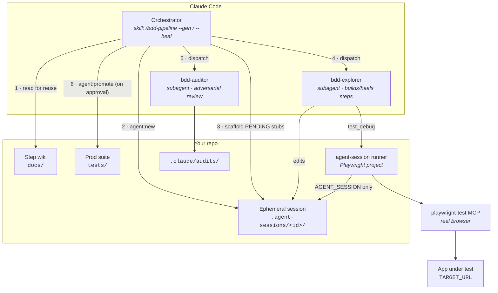
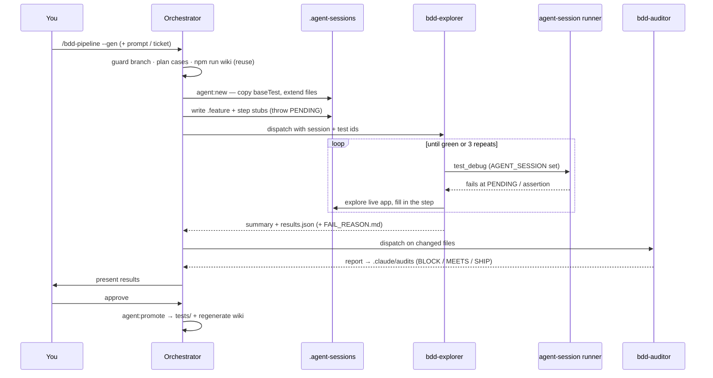
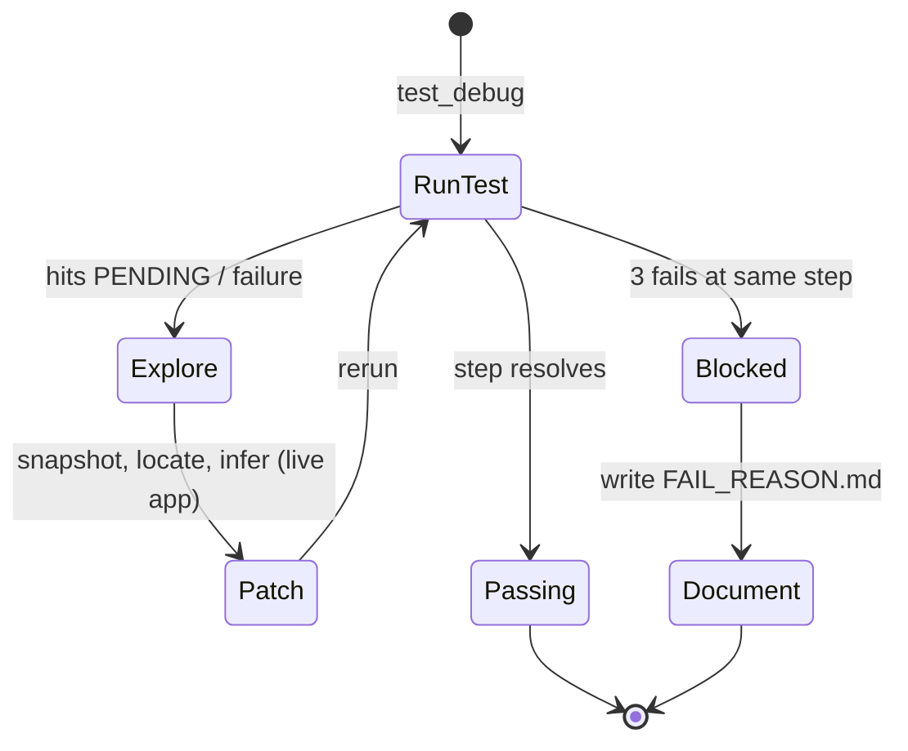
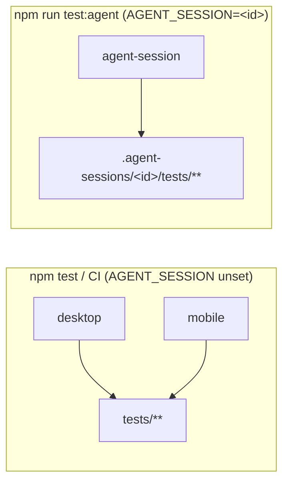
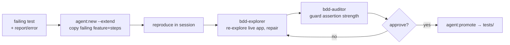
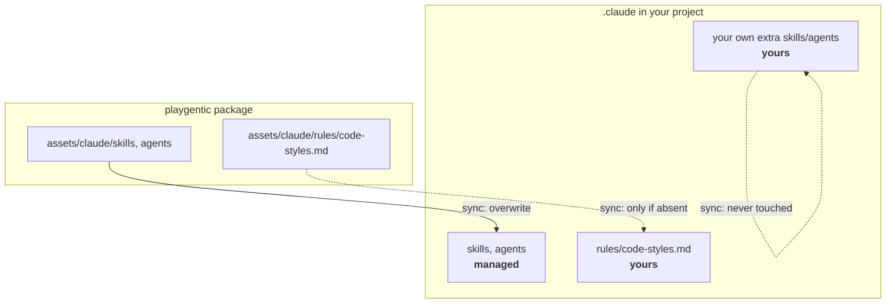

# playgentic — agent design

How the agent pipeline is put together, and why. This is the design doc for the pipeline that
ships in every scaffolded suite (`.claude/`). If you just want to *use* it, the scaffold's own
README is enough — this is for understanding and extending it.

## Design principles

| Principle | How it shows up |
| --- | --- |
| **Never touch prod on the way** | agents work only inside an ephemeral `.agent-sessions/<id>/` copy; `tests/` changes land only via an explicit promotion step |
| **Human gate at the end** | nothing merges without you running `agent:promote` after review |
| **Reuse before writing** | the orchestrator regenerates + reads the step wiki first, so new work reuses existing steps |
| **One tool touches the browser** | only the `bdd-explorer` subagent drives the `playwright-test` MCP; everyone else delegates |
| **Adversarial review** | a separate `bdd-auditor` challenges assertion strength and coverage before promotion |
| **Update agents in one place** | agent definitions live in the package and are pulled per-project via `playgentic sync` |

## Components

## The generation loop

`/bdd-pipeline --gen` adds coverage. The orchestrator plans and scaffolds; the explorer does all
live-browser work; the auditor reviews; you approve.

### The explorer's stub loop

New steps are scaffolded as stubs that **throw** — the thrown `PENDING exploration` is the
explorer's signal to go look at the real app. It never guesses locators from stale artifacts;
every exploration is fresh.

## Runner isolation

The agents run through a dedicated Playwright project, `agent-session`, that is **only defined
when `AGENT_SESSION` is set** and globs *only* that session's folder. Your real `desktop`/`mobile`
projects and CI never see it, and it can never resolve a file under prod `tests/`.

`agent:promote` is the *only* bridge from a session back to `tests/`: it lints the session's
docstrings, copies its `tests/**` over prod (extending existing files, adding new ones),
regenerates the wiki, and typechecks — aborting before it writes if anything fails.

## The healing loop

`/bdd-pipeline --heal` repairs broken/flaky tests. Same isolation, but it starts from an existing
failure and its priority is *not weakening the assertion to make it pass*.

## Keeping agents current: the sync model

Agent definitions are versioned in the playgentic package and pulled into each project. Files
split into two buckets so updates never fight your customizations:

`playgentic sync` overwrites the **managed** skills/agents to the shipped version, but never
overwrites `code-styles.md` (your team's standards, which the auditor reads) or any skill/agent
you added. Editing a managed file means you've forked it — the next `sync` will overwrite it, by
design. (Richer drift/merge handling is intentionally deferred.)

## Extending the pipeline

- **Auditor standards** — `.claude/rules/code-styles.md` is where most of the auditor's judgement
  comes from. The more concrete it is, the sharper the reviews.
- **Add a subagent/skill** — drop it in `.claude/`; `sync` leaves anything you add alone.
- **Change the runner** — the `agent-session` project in `playwright.config.ts` is a normal
  Playwright project; adjust its device/globs as needed.
