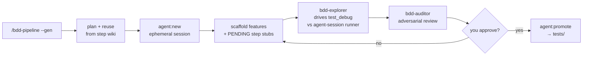

# Agentic Playwright-BDD Suite

A [playwright-bdd](https://github.com/vitalets/playwright-bdd) test suite scaffolded with
[playgentic](https://www.npmjs.com/package/playgentic), wired for a Claude Code agent pipeline
that writes and heals tests for you.

## Setup

```bash
cp .env.example .env        # set TARGET_URL to the app under test (required)
npm install
npx playwright install      # browsers
npm test                    # runs the example scenario
```

Update the agent definitions later with `npx playgentic sync`.

## Layout

```
tests/
  baseTest.ts               # BDD binding + the scenario-scoped `world` fixture
  features/*.feature        # Gherkin scenarios
  steps/*.steps.ts          # step definitions (each needs a docstring — see below)
scripts/                    # zero-dep tooling: wiki, step lint, agent sessions
docs/                       # generated step wiki (npm run wiki)
.claude/                    # agent skills, subagents, rules (managed by playgentic)
.agent-sessions/            # ephemeral agent workspaces (gitignored)
playwright.config.ts        # projects, reporters, the agent-only runner
```

## Core config & how to extend

| File | What it controls | Extend by |
| --- | --- | --- |
| `playwright.config.ts` | device projects, reporters, `baseURL`, the `agent-session` runner | add to the `targets` array (name + any Playwright `device`) to test more viewports; tune `timeout`/`retries`/`trace` in `use` |
| `tests/baseTest.ts` | the BDD `Given/When/Then` binding + the `world` fixture (scenario-scoped vars) | add fields to `World` and set them in the `world` fixture; add your own Playwright fixtures here |
| `.env` | `TARGET_URL` (required), `WORKERS`, `CI` | add any env your steps read via `process.env` |
| `.mcp.json` | the `playwright-test` MCP server the agents drive | — |
| `eslint.config.mjs` / `.prettierrc.json` | lint + format rules | standard eslint flat config / prettier options |
| `.husky/pre-commit` | `lint-staged` → `lint:steps` → `tsc` | add checks; `lint:steps` blocks commits with undocumented steps |

`targets` is a documented workaround for playwright-bdd's single-device limitation — each entry
becomes its own Playwright project generated into `.features-gen/<name>/`.

## npm commands

| Command | Does |
| --- | --- |
| `npm test` | `bddgen` then run all scenarios (all projects) |
| `npm run test:headed` / `:debug` / `:trace` / `:gui` | headed / inspector / trace / UI-mode runs |
| `npm run test:compile` | `bddgen` only — regenerate `.features-gen/` and check every step resolves |
| `npm run test:agent` | run the agent-only `agent-session` project (needs `AGENT_SESSION` set) |
| `npm run wiki` | parse step docstrings → regenerate `docs/` |
| `npm run lint:steps` | fail if any step lacks a compliant docstring (also runs in pre-commit) |
| `npm run agent:new "<name>" [--extend <path>]` | create an ephemeral agent session |
| `npm run agent:promote <session>` | promote a session's tests into `tests/` |
| `npm run lint` / `typecheck` / `format` | eslint / `tsc --noEmit` / prettier |
| `npm run report:playwright` | open the last HTML report |

## Writing steps

Every step needs a docstring — it feeds the wiki and is enforced by `lint:steps`:

```ts
/**
 * @domain checkout          // grouping/category (becomes a wiki page)
 * @description adds the current product to the cart
 * @prereq a product page is open   // or: none
 * @uses page, world               // fixtures/resources used, or: none
 */
When("I add the item to my cart", async ({ page }) => { /* ... */ });
```

### Finding steps & running subsets by tag

- **Reuse before writing:** run `npm run wiki` and browse `docs/index.md`, or grep a domain:
  `grep -rl "@domain checkout" tests/steps`.
- **Gherkin tags** (`@smoke`, `@desktop`, …) select scenarios at runtime:
  ```bash
  npx bddgen && npx playwright test --grep @smoke        # only @smoke
  npx bddgen && npx playwright test --grep-invert @slow  # skip @slow
  npx playwright test --project=desktop                  # one device project
  ```
- **Customize** by aliasing a filter into a script, e.g.
  `"test:smoke": "npx bddgen && playwright test --grep @smoke"`.

## The agent pipeline

In Claude Code, run `/bdd-pipeline --gen` (new coverage) or `--heal` (fix broken tests). The
orchestrator never edits your `tests/` directly — it works in an isolated `.agent-sessions/` copy
and only promotes on your approval:



- **Isolation:** only the `bdd-explorer` subagent launches the browser (via the `playwright-test`
  MCP), and only inside `.agent-sessions/`. A new step is scaffolded as a stub that throws
  `PENDING exploration: …`; the explorer hits that, explores the live app, and fills it in.
- **The runner:** the `agent-session` Playwright project only exists when `AGENT_SESSION` is set,
  and globs only that session — your real suite and CI never see it.
- **Promotion:** `agent:promote` lints the session's docstrings, copies its `tests/**` into yours
  (extending existing files, adding new ones), regenerates the wiki, and typechecks.

See the [playgentic agent design docs](https://github.com/BlaiseMoses01/playgentic/blob/main/docs/agent-design.md)
for the full picture.
